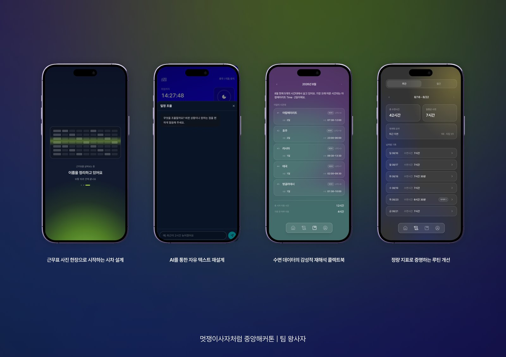
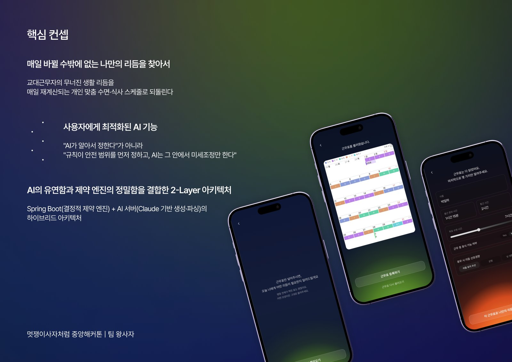
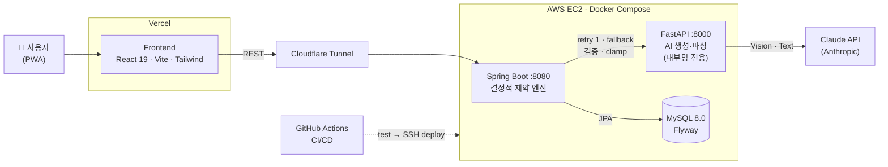
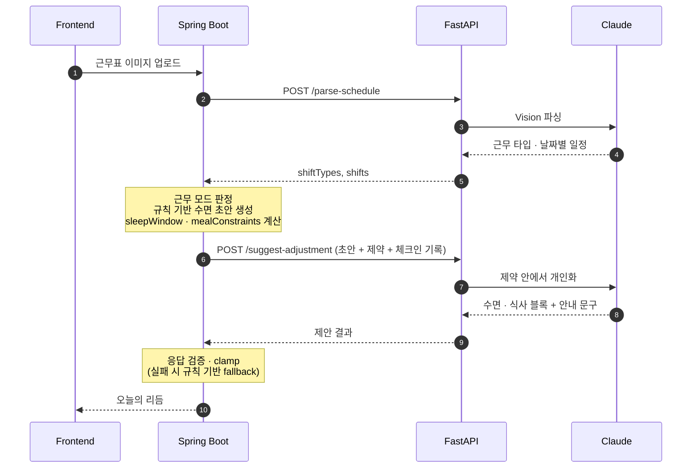

<div align="center">


# 시차 · Backend

**매주 바뀌는 근무표 속에서 살아가는 교대근무자를 위한 맞춤형 일주기 리듬 설계 솔루션**

멋쟁이사자처럼 14th 중앙해커톤 · 팀 왕사자

[Frontend Repo](https://github.com/jeehyung0922-lab/lion)

</div>

<br/>

## 📌 소개

> **비행기를 타지 않았을 뿐, 그들의 몸은 매주 시차를 겪습니다.**

WHO 산하 국제암연구소(IARC)는 일주기 리듬을 교란하는 교대근무를 **2A군 발암 가능 요인**으로 분류합니다.
하지만 기존 가이드는 "야간 근무 전 낮잠을 자라", "취침 6시간 전 카페인을 제한하라" 같은 추상적인 원칙에 머무릅니다.
교대근무자에게 정말 필요한 건 **"오늘 22시 출근인 내가 지금 당장 몇 시에 자야 하는가"** 라는 구체적인 시각입니다.

**시차**는 근무표 사진 한 장으로 시작해, 교대근무자의 무너진 생활 리듬을 **매일 재계산되는 개인 맞춤 수면·식사 스케줄**로 되돌립니다.
바뀌는 근무 리듬을 "시간대 이동"으로 표현해, 내가 이번 주에 몇 시간의 시차를 건너고 있는지 직관적으로 보여줍니다.

## ✨ 주요 기능



| 기능 | 설명 |
| --- | --- |
| 📷 **근무표 사진 한 장으로 시작** | 병동 근무표 이미지를 업로드하면 AI가 표의 근무 코드(D, 주간, 1조 등)를 주간·이브닝·야간·휴무로 해석해 날짜별 일정을 추출합니다. 여러 명이 있는 표라면 본인 행만 골라 읽습니다. |
| 💬 **AI 자유 텍스트 재설계** | "퇴근이 2시간 늦어졌어요"처럼 말하면 AI가 상황을 구조화하고, 남은 하루의 수면·식사 일정을 다시 짜 줍니다. |
| 🌏 **수면 데이터의 감성적 재해석, 콜렉트북** | 매일의 리듬 변화를 UTC 시간대와 나라로 바꿔, 이번 달 내가 지나온 "시간대"를 모아 볼 수 있습니다. |
| 📊 **정량 지표로 증명하는 루틴 개선** | 일·주·월 단위 리포트로 총 수면시간, 일평균 수면, 재계획 이력을 확인합니다. |
| 🌙 **체크인 기반 개인화** | 기상·퇴근 체크인(컨디션, 입면 시간, 수면 만족도)이 쌓일수록 추천이 더 정확해집니다. |

## 💡 핵심 컨셉



### "AI가 알아서 정한다"가 아니라, "규칙이 안전 범위를 먼저 정하고 AI는 그 안에서 미세조정만 한다"

수면은 건강과 직결되기 때문에, AI의 판단만 믿을 수 없습니다. 그래서 시차는 **2-Layer 하이브리드 아키텍처**를 택했습니다.

| Layer | 담당 | 역할 |
| --- | --- | --- |
| **1. 결정적 제약 엔진** | Spring Boot | 근무 모드 판정, 규칙 기반 수면 초안, 수면 가능 범위(`sleepWindow`)와 식사 제약(`mealConstraints`) 계산, AI 응답 검증 및 clamp, 실패 시 fallback |
| **2. AI 생성·파싱 레이어** | FastAPI + Claude | 근무표 이미지 파싱, 자연어 재설계 요청 파싱, 제약 범위 안에서 체크인 기록을 반영한 수면·식사 블록 개인화와 안내 문구 생성 |

- AI가 제안한 수면 시각은 Spring에서 다시 검증합니다. `sleepWindow` 밖으로 나가지 못하고, 규칙 기반 초안에서도 허용 오차 이상 벗어나지 못하도록 clamp합니다. 식사 시각도 컷오프와 야간 제한 구간을 피하도록 보정합니다.
- 수면·식사 제안 호출이 실패하면 규칙 기반 초안으로 fallback합니다. AI 서버가 응답하지 않아도 오늘의 리듬은 계속 계산됩니다.
- 근무 패턴은 7가지 모드로 분류합니다: `DAY`, `EVENING`, `NIGHT`, `SHIFT_TRANSITION`, `OFF_RHYTHM_MAINTAIN`, `OFF_RHYTHM_SHIFT`, `OFF_RECOVERY`.

## 🏗 SW 아키텍처



### 리듬 생성 흐름



## 🛠 기술 스택

### Backend


### AI Server


### Frontend


### Infra & DevOps


## 📂 레포 구조

```text
shiftrhythm-backend/
├── backend/                 # Spring Boot (8080, 외부 노출)
│   └── src/main/java/com/shiftrhythm/backend/
│       ├── domain/
│       │   ├── schedule/    # 근무 일정 · 모드 판정 · 수면/식사 제약 계산 (policy/)
│       │   ├── routine/     # 온보딩 · 오늘의 리듬 · 재설계(replan)
│       │   ├── checkin/     # 기상 · 퇴근 체크인
│       │   ├── jetlag/      # 리듬 변화 → UTC 시간대 매핑
│       │   ├── collectbook/ # 콜렉트북
│       │   ├── report/      # 일 · 주 · 월 리포트
│       │   └── ai/          # AI 서버 어댑터 (+ Fake 어댑터)
│       └── web/             # 공통 예외 처리
├── ai-server/               # FastAPI (8000, Docker 내부망 전용)
│   └── app/routers/         # parse_schedule · parse_disruption · suggest_adjustment
├── docs/images/             # README 이미지
└── docker-compose.yml
```

## 🔌 주요 API

| Method | Endpoint | 설명 |
| --- | --- | --- |
| `POST` | `/api/onboarding/schedule/parse` | 근무표 이미지 파싱 |
| `POST` | `/api/onboarding/schedule` | 근무표 등록 |
| `POST` | `/api/onboarding/profile` | 사용자 프로필 · 리듬 선호 등록 |
| `GET` | `/api/routines/today` | 오늘의 수면 · 식사 리듬 |
| `POST` | `/api/routines/replan/preview` | 자연어 재설계 미리보기 |
| `POST` | `/api/routines/replan/confirm` | 재설계 확정 |
| `POST` | `/api/checkins/wake` · `/clockout` | 기상 · 퇴근 체크인 |
| `GET` | `/api/collectbook` | 콜렉트북 |
| `GET` | `/api/reports/{daily,weekly,monthly}` | 리포트 |

전체 명세는 서버 실행 후 Swagger UI(`/swagger-ui/index.html`)에서 확인할 수 있습니다.

## 🚀 실행 방법

```bash
cp .env.example .env   # ANTHROPIC_API_KEY 등 환경변수 설정
docker compose up --build
```

| 서비스 | 포트 | 비고 |
| --- | ---: | --- |
| backend | 8080 | 외부 노출 |
| ai-server | 8000 | Docker 내부망 전용 |
| db | 3306 | Docker 내부망 전용 |

`main` 브랜치에 push하면 GitHub Actions가 테스트 후 EC2에 자동 배포합니다.
